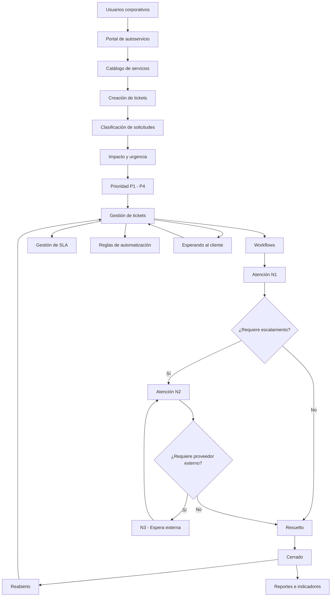

# Arquitectura Funcional del IT Service Desk

## 1. Descripción general

Diseño funcional de una solución empresarial de gestión de servicios de TI mediante Jira Service Management (JSM).

La solución centraliza solicitudes de soporte técnico, estandariza los procesos de atención y permite controlar prioridades, acuerdos de nivel de servicio (SLA), escalamiento y seguimiento de tickets.

## 2. Diagrama de arquitectura funcional

## 3. Componentes principales

### Portal de autoservicio

Permite a los usuarios corporativos registrar solicitudes, consultar sus tickets y dar seguimiento a su atención.

Incluye controles de acceso y restricciones de registro.

### Catálogo de servicios

Organiza los tipos de solicitudes disponibles para los usuarios.

Cada servicio puede contar con campos, reglas de atención, aprobaciones y flujos específicos.

### Gestión de tickets

Centraliza los incidentes y solicitudes de servicio, permitiendo administrar responsables, estados, prioridades y seguimiento.

### Motor de workflows

Define el ciclo de vida de cada ticket mediante estados, transiciones y condiciones operativas.

Contempla atención inicial, espera, escalamiento, resolución, cierre y reapertura.

### Gestión de SLA

Permite medir tiempos de primera respuesta y resolución.

Los cálculos consideran prioridades, calendario laboral y condiciones de pausa o reanudación.

### Reglas de automatización

Permiten ejecutar acciones según eventos y condiciones previamente definidas.

Su disponibilidad y ejecución dependen de la configuración y del licenciamiento de Jira Service Management.

### Escalamiento técnico

La solución contempla los siguientes niveles:

- N1: Atención inicial y diagnóstico.
- N2: Atención técnica especializada.
- N3: Escalamiento o espera de respuesta de un proveedor externo, según el servicio.

### Reportes e indicadores

Permiten consultar el desempeño de la operación mediante métricas de atención, resolución, cumplimiento de SLA y carga de trabajo.

## 4. Integración funcional

Los componentes trabajan de manera coordinada para administrar el ciclo de vida de las solicitudes.

El portal proporciona el punto de entrada, el catálogo organiza los servicios y los workflows controlan los estados del ticket.

Las prioridades y los SLA permiten establecer los criterios de atención, mientras que las automatizaciones apoyan la ejecución de procesos operativos.

Finalmente, los reportes permiten evaluar el funcionamiento de la mesa de servicio.

## 5. Alcance técnico

Este documento representa la arquitectura funcional de la solución, no la infraestructura interna de Atlassian.

El diagrama es conceptual. Determinadas rutas, automatizaciones y reglas de SLA varían según el servicio y las capacidades disponibles en el licenciamiento.

## 6. Competencias aplicadas

- Análisis de requerimientos.
- Diseño funcional de sistemas.
- Modelado de procesos empresariales.
- Diseño de reglas de negocio.
- Automatización de procesos.
- Integración funcional de componentes.
- Gestión de servicios de TI.
- Documentación técnica.
- Pruebas funcionales.

---

**Autor:** Martín Ramos

**Proyecto:** IT Service Desk Implementation

**Tecnología:** Jira Service Management

**Año:** 2026
