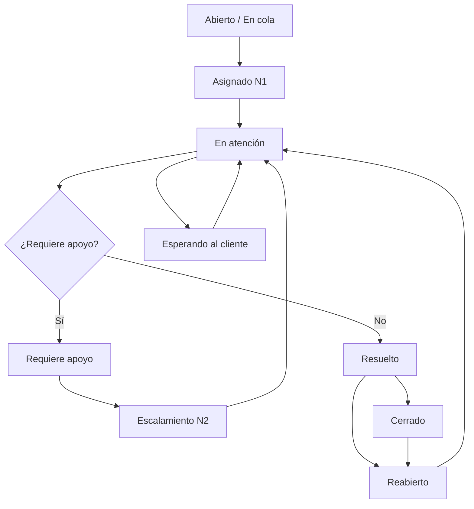

# Diseño de workflows

## Descripción

Diseño funcional de los flujos de trabajo para la gestión de incidentes y solicitudes de servicio mediante Jira Service Management.

Los flujos contemplan asignación, atención, espera, escalamiento técnico, resolución, cierre y reapertura de tickets.

## Flujo general de atención
  

## Consideraciones operativas

- Los tickets se clasifican por impacto y urgencia.
- Los SLA consideran horarios de servicio y condiciones de pausa.
- La atención puede escalarse a niveles técnicos superiores.
- Los tickets pueden reabrirse conforme a las reglas configuradas.

## Alcance

Diagrama conceptual de referencia. Las transiciones y condiciones específicas dependen del tipo de solicitud y de su configuración.
